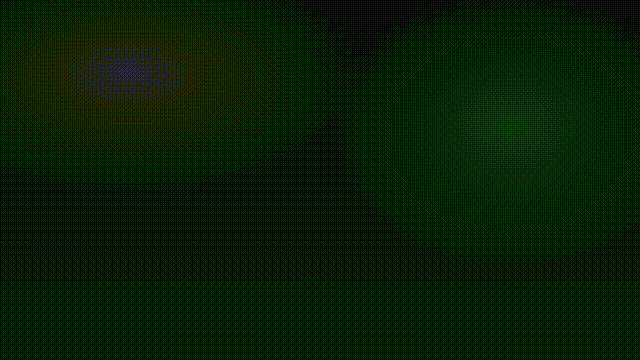

# FrameScript2



TSX で書く動画とモーショングラフィックス。レイアウトと描画は
[AntiWebUI](https://github.com/bea4dev/AntiWebUI)（wgpu、ブラウザなし）、スクリプトは deno_core 経由の V8
で動きます。

<a href="https://discord.gg/Gpjvht3BqM" data-size="large">
  
</a>

[English](./README.md)

- Web と同じようにコンポーネントと CSS で組み立て、アニメーションは `async` のスクリプトで書けます。
- フレームはフレーム番号だけで決まります。スタジオはどこへでも即座にシークでき、書き出しは多数のスレッドでフレームを分担します。
- 動画、音声、口パク、ベクター図形、WGSL シェーダー、3D シーン、glTF モデル。
- ブラウザを含まない単体のネイティブアプリです。Linux で動きます。Windows と macOS は対応したばかりで、まだあまり試されていません。

## AI でクイックスタート

AI エージェントに任せれば、FrameScript のインストール、使い方の把握、動画の作成までをやってもらえます。

1. Rust を入れます: [rustup.rs](https://rustup.rs)。Windows では Visual Studio の Build Tools
   （「C++ によるデスクトップ開発」）も必要です。
2. 空のディレクトリで、コマンドを実行でき画像を見られる AI コーディングエージェント
   （[Claude Code](https://claude.com/claude-code) など）を開きます。**モデルはフロンティアモデル、
   特に Claude Opus か Claude Fable を強く推奨します。** 動画作りは、アニメーションのコードを書き、
   描いたフレームを見て判断することの繰り返しです。小さなモデルでは途中で迷いがちです。
3. 次のように頼みます（最後の行を作りたい動画の説明に置き換えてください）。

   ```text
   https://raw.githubusercontent.com/frame-script/FrameScript/main/AGENTS.md を読んで、それに従ってください。
   FrameScript をインストールし、ここに my-video というプロジェクトを作って、次の動画を作ってください。
   完成と言う前に、フレームを描画して見た目を確かめてください。

   チャンネル「Night Coding」の 20 秒のオープニング。タイトルが一文字ずつ打ち込まれて……
   ```

4. `sudo` が必要なインストールがあると、エージェントがコマンドを示します。それを自分で実行し
   （Claude Code なら `! <コマンド>`）、続けるよう伝えてください。
5. `framescript my-video` でスタジオを開いて確認し、直したいところをエージェントに頼みます。
   できあがったら書き出しを頼むか、`framescript export my-video` を実行します。

## クイックスタート

```sh
cargo install --git https://github.com/frame-script/FrameScript create-framescript
create-framescript my-video     # 必要なものを確認し、FrameScript を入れ、プロジェクトを作る
framescript my-video            # スタジオで開く
```

`create-framescript` は、パッケージや FFmpeg 9 を入れる前に必ず確認を取ります。詳しくは
[インストール](docs/installing.md)（英語）を見てください。別のコンピュータから持ってきた（clone した）プロジェクトは、
`create-framescript sync <dir>` でこのコンピュータの FrameScript を指すように直せます。

## 概要

プロジェクトは、`framescript.json` とエントリのモジュールがあるディレクトリです。エントリの
default export が動画になります。

```json
{ "name": "hello", "width": 1920, "height": 1080, "fps": 60, "entry": "main.tsx", "background": "#0b1020" }
```

```tsx
import { BEZIER_SMOOTH, Clip, FillFrame, seconds, Timeline, useAnimation, useVariable } from "framescript"

export default function Main() {
  return (
    <Timeline>
      <Clip label="intro" duration={seconds(3)}>
        <Intro />
      </Clip>
    </Timeline>
  )
}

function Intro() {
  const position = useVariable({ x: -300, y: 0 })
  const opacity = useVariable(0)

  useAnimation(async (ctx) => {
    await ctx.parallel([
      ctx.move(position).to({ x: 240, y: 0 }, seconds(1.2), BEZIER_SMOOTH),
      ctx.move(opacity).to(1, seconds(0.6)),
    ])
  })

  return (
    <FillFrame>
      <div
        style={{
          width: 120,
          height: 120,
          borderRadius: 999,
          background: "#38bdf8",
          opacity,                                       // 変数はそのまま渡すと追従する
          translate: () => [position().x, position().y], // 関数も追従する
        }}
      />
    </FillFrame>
  )
}
```

- **コンポーネントは一度だけ実行されます**（React ではなく SolidJS と同じ）。時間で変わるものは関数か変数で書き、
  それを読んでいるところだけが更新されます。`style={{ x: () => … }}` は追従し、JSX の中の `{frame()}` は追従しません。
  [ひとつだけのルール](docs/reactivity.md)を見てください。
- **時間の単位はフレームです。** `seconds(n)` で秒をフレームに直します。`useVariable` の値を `useAnimation`
  が動かします。動きを `await` すると進むのはスクリプトの時計で、プログラムが止まるわけではありません。
- **クリップはレイヤーです。** `<Clip>` は自分の長さのあいだ表示され、自分のフレームを持ちます。`<Sequence>`
  はクリップを順番に並べます。
- **要素**は `<div>`、`<text>`（ひと続きの文字）、``、`<svg>` で、CSS（camelCase、数値は px）で
  スタイルを付けます。`<Video>`、`<Audio>`、`<Shader>`、`framescript/3d` がそれ以外を受け持ちます。
- `framescript render my-video --frame 60 --out a.png` で 1 フレームを描画、`framescript export my-video`
  で動画を書き出し、`framescript my-video` でスタジオを開きます。

## ドキュメント

ドキュメントは英語です（設計資料だけ日本語）。

| | |
|---|---|
| [インストール](docs/installing.md) | `create-framescript`、必要なもの、FFmpeg |
| [プロジェクト・コマンド・スタジオ](docs/project.md) | ファイル構成、`framescript.json`、`render`、`export` |
| [ひとつだけのルール](docs/reactivity.md) | コンポーネントは一度だけ実行され、変わるものは関数 |
| [クリップ・フレーム・アニメーション](docs/timeline.md) | `<Clip>`、`<Sequence>`、`useAnimation`、イージング |
| [スタイル](docs/styles.md) | 要素、CSS、文字の影と縁取り |
| [画像・動画・音声](docs/media.md) | ``、`<Video>`、`<Audio>`、`<LipSync>` |
| [ベクター描画](docs/svg.md) | フレームごとに変えられる SVG の図形 |
| [WGSL](docs/shaders.md) | `<Shader>` |
| [3D](docs/3d.md) | シーン、glTF モデル、ライト、影、マテリアル |
| [書き出し](docs/export.md) | コーデック、品質、サイズ、ワーカー |
| [動画の確認](docs/checking.md) | フレームを描画して画像で確かめる方法（AI エージェント向け） |
| [設計](docs/design/00-overview.md) | 内部の仕組みとその理由（日本語） |

## AI エージェント向け

まず [AGENTS.md](AGENTS.md) を読んでください。FrameScript のインストール、プロジェクトの作成、各機能のドキュメントの
場所が書いてあります。続いて [docs/README.md](docs/README.md) とそこに挙がっているページを読みます。ライブラリの型は
`packages/framescript`（`index.ts` と `3d.ts`）にあります。`create-framescript` で作ったプロジェクトには、
そのプロジェクト用の `AGENTS.md` も入っています。

**エージェントは動画を自分で確認しなければいけません。** 変更のたびと「完成」と言う前に、フレームを描画して画像を
見てください。コードを読むだけでは、何がどこに描かれるかは分かりません。1 フレームの確認から書き出したファイルの確認まで、
やり方は [docs/checking.md](docs/checking.md) にあります。

## ソースからのビルド

```sh
cargo run --release -- examples/hello                        # スタジオ
cargo run --release -- render examples/hello -f 120 -o a.png # 1 フレームを PNG に
cargo run --release -- export examples/hello -o hello.mp4    # 動画全体
cargo test --workspace
```

リポジトリの構成は [docs/README.md](docs/README.md#the-repository) にあります。
